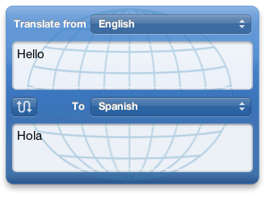
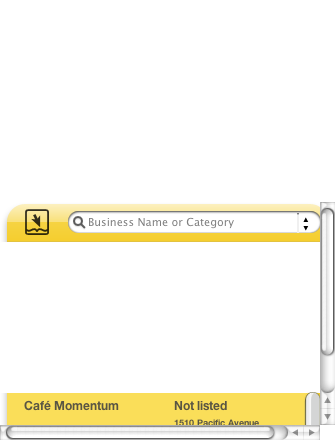
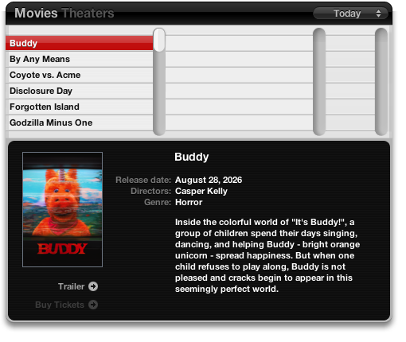
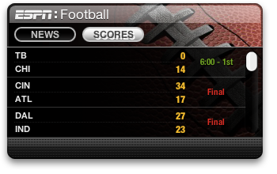

# Dashboard Widget Restorer

Version **1.0**, for **Mac OS X 10.4.11 Tiger, 10.5.8 Leopard and 10.6.8 Snow Leopard Dashboard**.

This project modifies the data providers behind Apple's existing widgets. It
preserves their built-in artwork, layout, native controls, animations, and
search/result views while communicating over TLS 1.2 and 1.3.

## Behavior

| Widget | Interface and service |
| --- | --- |
| Weather | Original scene, back-side location field and native results menu. Open-Meteo weather. |
| Phone Book / Business | Original yellow widget, native category/name input, preferences, paging and result list. Photon/OSM names, addresses and map links. Search distance is respected. Missing phone numbers say “Not listed”; they are not fabricated. |
| Translation | Original blue globe widget, language menus, swap control and resizable text areas. |
| Flight Tracker | Original gray widget, airline/airport native inputs, flight list, map and tracking view. Aviationstack adapter and an offline airport-coordinate lookup. **Optional user API key required.** |
| Ski Report | Original wooden resort/signpost scene, location search and unit controls. Open-Meteo model estimates at the selected location; a snowflake or crossed-out snowflake indicates modeled snow presence. Missing trails/surface observations remain unavailable. |
| Stocks | Original list, symbol search and charts. Yahoo Finance public endpoints; quotes may be delayed. |
| Currency | Original Unit Converter. Frankfurter daily reference rates; other conversions stay local. |
| Google | Original widget with query escaping and HTTPS search repaired. |
| ESPN | Snow Leopard’s original sports backgrounds, league menu, scoreboard and news crawl use ESPN feeds. MLB, NBA, WNBA, NHL, NFL and college basketball/football are supported. Tiger uses a fallback only when its original bundle is incomplete. |
| Movies (Leopard / Snow Leopard) | Original poster carousel, browser and movie details. Apple’s catalog and H.264 previews need no key. Local cinema schedules use an optional API Cinema key entered on the original settings side. |
| People / White Pages (Leopard / Snow Leopard) | Original name/location form opens Whitepages web results; it does not pretend to return a working public-directory feed inside Dashboard. |

People/white-pages and OS/browser limitations are documented in
[the widget audit](docs/WIDGET-AUDIT.md). Service coverage is not expanded by
keeping the original appearance: free map data still lacks telephone listings,
and a weather model does not report open lifts/trails.

## Original interfaces restored




[Flight Tracker preview](docs/images/flight-tracker.png) · [Ski Report preview](docs/images/ski-report.png)

### Snow Leopard originals




The project was previously named Tiger Widgets. Existing `TigerWidgets` runtime,
cache and configuration paths remain compatible so saved keys and backups survive
an upgrade to Dashboard Widget Restorer.

## Install and uninstall

The release DMG or ZIP contains native Installer packages for both supported systems:

- **DashboardWidgetRestorer-1.0.pkg** — install or update; original bundles are backed up.
- **Uninstall-DashboardWidgetRestorer-1.0.pkg** — restore original bundles and remove the
  shared runtime. Preferences, API keys and recovery copies are kept.

Close Dashboard before installing, then reload it. Logging out/back in works;
experienced users can run `killall Dock` and reopen Dashboard. Packages require
Tiger 10.4.11, Leopard 10.5.8 or Snow Leopard 10.6.8, but no Xcode, host proxy, Homebrew, or separate TLS installation.
PowerPC Tiger, i386 Leopard and i386 Snow Leopard are runtime-tested. The helper contains both architectures.

From a built checkout you can double-click `Install.command` / `Uninstall.command`,
or select modules:

```sh
sudo python scripts/manage.py install Weather "Phone Book" Translation "Flight Tracker" "Ski Report"
sudo python scripts/manage.py uninstall
```

Install/update is staged from the preserved originals, not from previously
patched bundles. Original backups are never overwritten. A lock prevents
concurrent install/uninstall operations. See [verification](docs/VERIFICATION.md).

## Weather location search

Flip the widget over and type a city or postal code, for example `Dallas, TX`
or `Paris, France`. Pause briefly: the existing native results menu appears.
Select a match and use the original Done button. Editing clears stale coordinates;
late responses from previous searches are ignored.

## Optional flight key

Open Flight Tracker's **info / flip** side, paste your Aviationstack API key into
its password field, and click **Done**. The **Get a free API key** link opens
[Aviationstack signup](https://aviationstack.com/signup/free). Leaving the field
blank retains a saved key; **Remove key** clears it. No key is shipped.


The installer creates a private, empty `aviationstack.key` configuration file for
existing local users. Updates preserve existing keys. The widget also prepares
configuration for users added later. Keys are saved in
`~/Library/Application Support/TigerWidgets/aviationstack.key` with mode 600,
owned by the user, and never stored in widget preferences, source, or packages.

The adapter supports the original airline, flight-number and departure/arrival
filters. Tracking refreshes are cached for 30 minutes; free provider allowances
are small. Airport coordinates are local map data, not live plane positions.
Authenticated tracking was tested using a privately supplied key; no key is included in the repository or releases.

## Leopard and Snow Leopard Movies and People

Movies uses Apple's no-account movie catalog by default. The listed films are
store catalog titles, **not a claim that they are playing at nearby cinemas**.
Posters and previews are fetched through the bundled TLS helper into private
local cache files. The system's video decoder plays the previews behind the
widget's original playback controls; the obsolete QuickTime plug-in is not used.

For real cinema listings, obtain an optional free account/key from
[API Cinema](https://api-cinema.com/en/docs), flip Movies over, paste the key,
set your city/state, and click Done. A blank key field keeps the existing key;
Apple's catalog and trailer playback remain available with a cinema key. Cinema
films also look up matching Apple previews by title and release year; Apple may
not have previews for every theatrical release. Catalog-only films do not acquire
local showtimes. If local listings are unavailable, the widget still loads the
Apple catalog. Remove returns to the no-key catalog. The key stays in your private `cinema.key`
file with mode 600. Queries return up to 100 showtimes within 25 km for the
selected day. Provider coverage, country support, account quotas and incomplete
metadata apply. Authenticated showtimes and poster loading have been verified on Leopard and
Snow Leopard with a privately supplied key. No key is included in this project. Metadata comes through API Cinema/TMDB;
this project is not endorsed or certified by TMDB.

People keeps the original White Pages form but opens results in your default
browser. No directory subscription or key is required by this integration.
The website controls which details are available and may require a modern browser.

## Source and offline build

```text
src/                  ES3 service adapters and HTTPS client
scripts/              build, install/uninstall, package and release tooling
tests/                regressions and native Dashboard WebKit integration
third_party/mbedtls/   complete patched 3.6.7 source, headers, libraries, CA bundle
third_party/airports/  public airport CSV, attribution and generation notes
docs/                 architecture, providers, audit and verification
```

The helper builds on Tiger with Xcode 2.5, Leopard with Xcode 3.x, or Snow
Leopard with Xcode 3.x, using the installed MacOSX10.4u SDK. `make test` selects
the native CPU architecture and the widgets available on that system.
Release package creation uses Tiger's PackageMaker 2.1 workflow.

From a development checkout:

```sh
make tls              # optional full offline TLS rebuild
python scripts/make-airports.py
make                  # universal PowerPC/i386 helper
sudo python scripts/manage.py install
make test             # installed-widget native tests
make package          # native install and uninstall packages
make release          # HFS+ DMG, ZIP, complete source tarball
```

On a modern host: `node tests/unit.js`. The source tree includes everything needed
for the legacy build; it does not need to fetch TLS or airport data. See
[TLS provenance](third_party/mbedtls/PROVENANCE.md) and
[airport attribution](third_party/airports/README.md).

Apple widget implementation files and reusable artwork are read from the target
Mac, not shipped in the installer. Documentation screenshots show local renders.
The missing ESPN bundle has project-owned fallback artwork.

## Runtime, data and privacy

- Bundles: `/Library/Widgets/`.
- Runtime/source snapshot/backups: `/Library/Application Support/TigerWidgets/`.
- Private cache: `~/Library/Caches/TigerWidgets/`.
- Optional key: `~/Library/Application Support/TigerWidgets/`.

No server, daemon, login item, analytics or host-side proxy is installed. TLS
hostname and certificate-chain validation remain mandatory. Requests use named
provider routes and bounded responses. The response-file bridge avoids Tiger's
4 KB command-output truncation. Widget permissions allow running the helper and
reading its private local response files.

Queries, selected locations, translation text and requested flight details go to
the respective providers. Caches/preferences can remain after uninstall. Keys
are user-private and never included in source archives. Update the CA bundle as
roots change. [Provider terms and limits](docs/PROVIDERS.md) apply.

## License

New code: [MIT](LICENSE). mbedTLS: Apache-2.0 with upstream notices. Airport data:
see its attribution. Apple's widgets/artwork remain subject to Apple's license.
Provider data retains its own terms. This is a development release, not a promise
that unofficial/free endpoints will remain unchanged.
